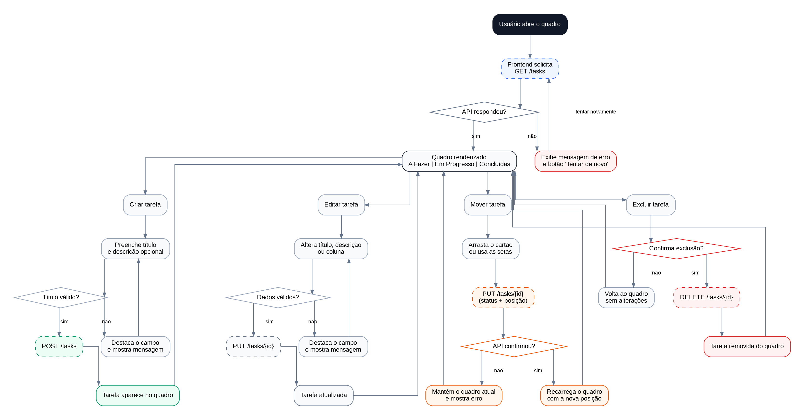

# Mini Kanban de Tarefas — Desafio Fullstack Veritas

Aplicação fullstack desenvolvida para o desafio técnico da Veritas Consultoria Empresarial.
O sistema possui três colunas fixas — **A Fazer**, **Em Progresso** e **Concluídas** — e permite criar, editar, mover e excluir tarefas.


## Tecnologias

- **Frontend:** React 18 + Vite
- **Backend:** Go 1.22+ com `net/http`
- **Persistência:** memória, com opção de arquivo JSON
- **Testes:** testes automatizados no backend
- **Bônus implementados:** drag and drop, JSON, Docker e testes

## Como rodar

### Backend

Pré-requisito: Go 1.22+

```bash
cd backend
go run .
```

A API ficará disponível em:

```text
http://localhost:8080
```

Por padrão, o quadro inicia vazio. Para criar tarefas de exemplo:

```bash
SEED=true go run .
```

### Frontend

Pré-requisitos: Node.js 18+ e npm.

```bash
cd frontend
npm install
npm run dev
```

A interface ficará disponível, normalmente, em:

```text
http://localhost:5173
```

### Docker (opcional)

Também é possível iniciar frontend e backend juntos:

```bash
docker compose up --build
```

## API

| Método | Rota | Ação |
| --- | --- | --- |
| `GET` | `/tasks` | Lista as tarefas |
| `POST` | `/tasks` | Cria uma tarefa |
| `PUT` | `/tasks/{id}` | Edita ou move uma tarefa |
| `DELETE` | `/tasks/{id}` | Exclui uma tarefa |
| `GET` | `/health` | Verifica se a API está ativa |

O título é obrigatório e o status precisa ser um dos valores:

- `todo`
- `doing`
- `done`

Exemplo de criação:

```bash
curl -X POST http://localhost:8080/tasks \
  -H "Content-Type: application/json" \
  -d '{"title":"Estudar Go","description":"Revisar os handlers da API"}'
```

## Estrutura do projeto

```text
desafio-fullstack-veritas/
├── backend/
│   ├── main.go
│   ├── handlers.go
│   ├── models.go
│   ├── store.go
│   ├── middleware.go
│   └── *_test.go
├── frontend/
│   ├── src/
│   │   ├── components/
│   │   ├── hooks/
│   │   └── lib/
│   └── package.json
├── docs/
│   └── user-flow.png
├── docker-compose.yml
└── README.md
```

## Decisões técnicas

### Backend

O backend foi feito com a biblioteca padrão do Go e separado em arquivos por responsabilidade:

- `models.go`: modelo da tarefa e validações;
- `handlers.go`: endpoints HTTP;
- `store.go`: armazenamento das tarefas;
- `middleware.go`: CORS e tratamento básico das requisições;
- `main.go`: inicialização da aplicação.

As tarefas são mantidas em memória durante a execução. Como bônus, o estado também pode ser salvo em um arquivo JSON para permanecer disponível após reiniciar o backend.

O backend também mantém a posição de cada tarefa dentro da coluna. Ao mover uma tarefa, a ordem é recalculada para manter o quadro consistente.

### Frontend

O frontend foi dividido em componentes React para manter o código organizado. As chamadas à API ficam separadas da interface, e o estado das tarefas é centralizado no hook `useTasks`.

O drag and drop utiliza a API nativa do navegador para mover tarefas entre as três colunas. Também existem botões de seta como alternativa para teclado, toque ou uso sem arrastar.

Há feedback visual para:

- carregamento inicial;
- erros de comunicação com a API;
- validação do formulário;
- criação, edição, movimentação e exclusão de tarefas.

## Documentação

### User Flow

O diagrama obrigatório mostra o caminho do usuário desde a abertura do quadro até as quatro ações principais do CRUD.



## Testes

Para executar os testes do backend:

```bash
cd backend
go test ./...
```

Os testes cobrem os principais comportamentos da API e do armazenamento, incluindo criação, edição, exclusão, movimentação e validações.

## Limitações conhecidas

- Não há autenticação ou usuários diferentes.
- O arquivo JSON é adequado apenas para um projeto pequeno; em uma aplicação real seria melhor utilizar um banco de dados.
- O frontend não possui testes automatizados.
- Não há sincronização em tempo real entre diferentes abas ou usuários.

## Melhorias futuras

- adicionar testes automatizados no frontend;
- utilizar PostgreSQL ou SQLite para persistência;
- adicionar autenticação;
- incluir filtros e busca de tarefas;
- adicionar atualização em tempo real.

---

Desenvolvido para o processo seletivo de estágio Full Stack da **Veritas Consultoria Empresarial**.
